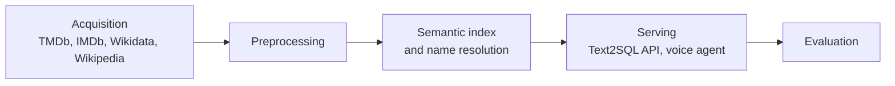

# Philippe Vaugouin

Coder and consultant near Paris, working with AI agents. Bilingual French and English.

I connect existing AI agents to a large movie and TV database so that people can talk to it. You ask a question out loud, the way you would ask a film buff, and the answer comes back as something to explore, full of posters and images, where each answer leads to the next question. I don't build the agents, I wire them to my data, and I build all of it with Claude Code and Codex.

I am also a regular contributor to [TMDb](https://www.themoviedb.org/u/vaugouin), the community database that feeds this work, so I sit on both sides: the one who queries the data and the one who adds to it.

## How the repositories fit together

Most of the public repositories below are stages of one pipeline. They converge on a shared MariaDB database and a ChromaDB vector store.

**Acquisition**

- [tmdb-crawler](https://github.com/vaugouin/tmdb-crawler): daily sync of movies, series and people from the TMDb API.
- [imdb-crawler](https://github.com/vaugouin/imdb-crawler): imports the IMDb dataset files.
- [omdb-crawler](https://github.com/vaugouin/omdb-crawler): imports Rotten Tomatoes, Metacritic and US box-office figures from the OMDb API for every title with an IMDb ID.
- [wikidata-crawler](https://github.com/vaugouin/wikidata-crawler): streams the Wikidata dumps into a statement and value schema.
- [wikipedia-crawler](https://github.com/vaugouin/wikipedia-crawler): English and French Wikipedia pages for every entity with a Wikidata ID.
- [selenium-tmdb](https://github.com/vaugouin/selenium-tmdb): batch repair of Wikidata IDs on TMDb.
- [download-images](https://github.com/vaugouin/download-images) and [synthetic-images](https://github.com/vaugouin/synthetic-images): real images, and style-locked illustrations for entities that have none.
- [image-captioning](https://github.com/vaugouin/image-captioning): captions TMDb backdrop images with a Claude vision model, grounded in each film's own data, so the right still can be retrieved at the right beat of a generated video.
- [manual-refresh](https://github.com/vaugouin/manual-refresh): refreshes one title or person on demand.
- [sparql-crawler](https://github.com/vaugouin/sparql-crawler) and [sparql-movies-persons](https://github.com/vaugouin/sparql-movies-persons): the earlier SPARQL crawlers, deprecated in favour of wikidata-crawler.

**Preprocessing**

- [tmdb-movie-preprocess](https://github.com/vaugouin/tmdb-movie-preprocess) and [tmdb-person-preprocess](https://github.com/vaugouin/tmdb-person-preprocess): enrichment and normalisation of movies and people.

**Semantic index and name resolution**

- [embedding-update](https://github.com/vaugouin/embedding-update) and [embedding-query](https://github.com/vaugouin/embedding-query): the ChromaDB collections and a tool to test them.
- [rapidfuzz_query](https://github.com/vaugouin/rapidfuzz_query): fuzzy person-name search and autocorrect.

**Serving**

- [fastapi-text2sql](https://github.com/vaugouin/fastapi-text2sql): turns natural-language questions into SQL, as a REST API and an MCP server.
- [voice-agent](https://github.com/vaugouin/voice-agent): the voice and chat front end.
- [t2s-web](https://github.com/vaugouin/t2s-web): a web client for the API.
- [listening-companion](https://github.com/vaugouin/listening-companion): a silent visual companion for movie conversations.

**Evaluation and monitoring**

- [text2sql-eval](https://github.com/vaugouin/text2sql-eval): the Cinéphile Bench, 902 questions in English and French, scored on every run.
- [extract-movie-questions](https://github.com/vaugouin/extract-movie-questions): pulls movie and TV questions out of a trivia corpus.
- [data-monitoring](https://github.com/vaugouin/data-monitoring): nightly progress reports for long data backfills.

## Other projects

- [open-credits](https://github.com/vaugouin/open-credits): crowdsourced OCR of on-screen movie and series credits, for TMDb and Wikidata.
- [subtitle-translate](https://github.com/vaugouin/subtitle-translate): translates subtitle files with OpenAI models.
